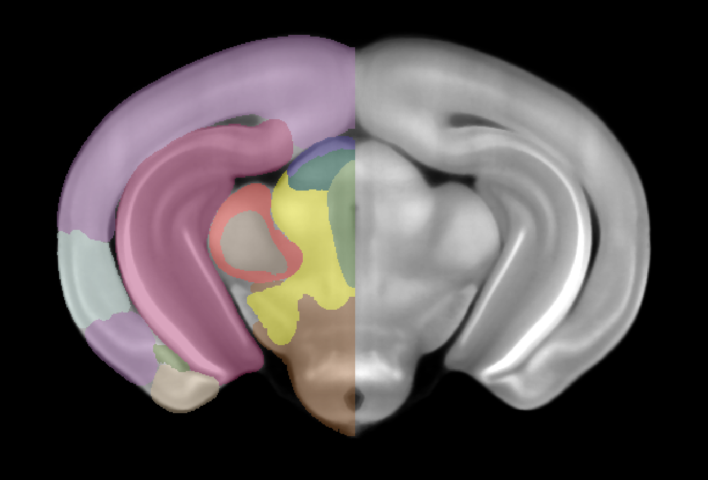

# An African mole-rat brain atlas has been added to BrainGlobe

The [Malkemper Lab](https://mpinb.mpg.de/en/research-groups/groups/neurobiology-of-magnetoreception/research-focus.html) recently worked with the BrainGlobe team to make a new atlas for the African mole-rat (*Fukomys anselli*). As explained in their recent preprint ([Zhang et al. (2026)](https://doi.org/10.64898/2026.10.04.756554)), they used it to study mole-rat behaviour in  the absence of an Earth-strength magnetic field.

We created the template with our established [template creation pipeline](uncharted-brains.md). As inputs, we had light-sheet fluorescence microscopy (LSFM) images of 43 hemispheres. Each hemisphere was mirrored to create a full symmetric brain before averaging. The size and number of these images required us to optimise the template creation process further, so we improved our scripts to ensure they run the registrations steps of template creation in parallel.

The atlas is available at 20 µm resolution through BrainGlobe as `african_molerat_20um`.

**Figure 1: A coronal section of the African mole-rat brain atlas visualised with `brainrender-napari`.**

The atlas also includes four additional reference images that show the vasculature of a single individual:

* `african_molerat-vascular-template`
* `african_molerat-vascular_AP-smoothed-template`
* `african_molerat-vascular_DV-smoothed-template`
* `african_molerat-vascular_ML-smoothed-template`

The vascular image was acquired with LSFM and registered to the main template's space. The other three images are smoothed versions of it, each using a one-dimensional Gaussian kernel along a different axis: anteroposterior (AP), dorsoventral (DV), or mediolateral (ML). These images provide registration targets for functional ultrasound imaging (fUSI), where the appearance of blood vessels depends on the imaging angle.

## How do I use the new atlas?

You can use the African mole-rat atlas like other BrainGlobe atlases. To visualise it, you can either open it 
[in NeuroGlancer for viewing in the browser](https://neuroglancer-demo.appspot.com/#!https://brainglobe.s3.amazonaws.com/ng_state_files/african_molerat.json) or you can view them locally:

* Install BrainGlobe ([instructions](/documentation/index)).
* Open napari and follow our [download tutorial](/tutorials/manage-atlases-in-GUI.md) to install `african_molerat_20um`.
* Run `napari -w brainrender-napari` and follow our [visualisation tutorial](/tutorials/visualise-atlas-napari).

## Why are we adding new atlases?

A fundamental aim of the BrainGlobe project is to make brain atlases from many species easy to access. If you would like to get involved with a similar project, please [get in touch](/contact).
