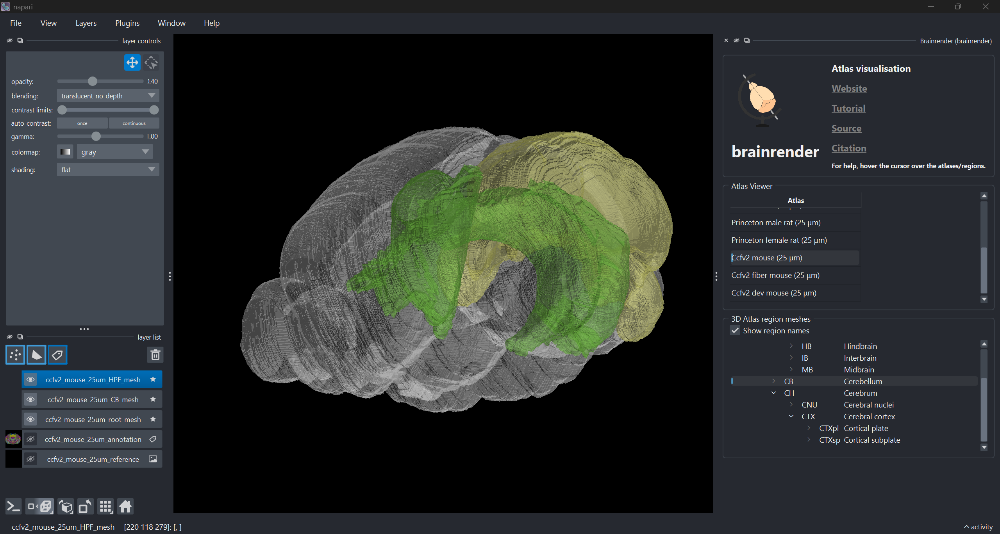

# The first edition of the Allen Mouse Brain Atlas has been added to BrainGlobe

TODO: Write the blogpost!

There are few brain atlases as foundational to the field as the first Allen Mouse Brain Atlas, released in 2006. The first edition of the atlas, Common Coordinate Framework version 1 (CCFv1), was created as part of the inaugural project of the Allen Institute for Brain Sciences, which was to create a whole-brain map of gene expression. This framework allowed researchers to align in situ hybridisation (ISH) data to the atlas, which was a valuable tool for neuroscientists. 

The team at BrainGlobe have packaged the CCFv1 mouse brain atlas using data provided by the Allen Institute to preserve this atlas and make it accessible through our ecosystem, and to allow for the reproduction of historical results which used this atlas. The CCFv1 atlas template was created using 528 Nissl-stained OCT-embedded coronal mouse brain sections taken from male C57Bl/6J mice sectioned at 25μm thickness. These were then annotated using the Allen Reference Atlas, which in itself was made of 132 coronal 100μm sections and 21 sagittal 200μm sections, and contained only the left hemisphere. Thus, the CCFv1 atlas is an atlas with 25μm resolution, and with only the left hemisphere annotated. 


## 1. CCFv2 Mouse Brain Atlas
```{image} ./images/ccfv2_mouse_brain.png
:alt: ccfv2 mouse brain atlas annotations
:width: 830px
```

**Figure 1. Anterior view of the CCFv2 Mouse Brain atlas annotations and reference image.**

## 2. CCFv2 Mouse Fiber Tracts Atlas
```{image} ./images/ccfv2_fiber_mouse.png
:alt: ccfv2 mouse fiber tracts atlas annotations
:width: 830px
```

**Figure 2. Anterior view of the CCFv2 Mouse Fiber Tracts atlas annotations and reference image.**

## 3. CCFv2 Developmental Mouse Brain Atlas
```{image} ./images/ccfv2_dev_mouse.png
:alt: ccfv2 developmental mouse brain atlas annotations
:width: 830px
```

**Figure 3. Anterior view of the CCFv2 Developmental Mouse Brain atlas annotations and reference image.**


The BrainGlobe team re-packaged the data generated and made public by the Allen Institute, making it now possible to use the CCFv2 mouse atlases within the BrainGlobe ecosystem. The atlas names are `ccfv2_mouse_25um`, `ccfv2_fiber_mouse_25um`, and `ccfv2_dev_mouse_25um`.

## How do I use the new atlases?

You can use the CCFv2 atlases for visualisation like other BrainGlobe atlases, as written below:

* Install BrainGlobe ([instructions](/documentation/index))
* Open napari and follow the steps in our [download tutorial](/tutorials/manage-atlases-in-GUI.md) for the CCFv2 atlas
* Visualise the different parts of the atlas as described in our [visualisation tutorial](/tutorials/visualise-atlas-napari)

The end result will look something like Figure 4.



**Figure 4: The CCFv2 Mouse Brain atlas visualised with `brainrender-napari`: with mesh overlays for the brain (grey), the hippocampal formation (green) and the cerebellum (yellow).**

## Why are we adding new atlases?

A fundamental aim of the BrainGlobe project is to make various brain atlases easily accessible by users across the globe. The CCFv2 Mouse Brain atlases allow for users to use historical versions of the Allen 3D atlases easily on BrainGlobe. If you would like to get involved with a similar project, please [get in touch](/contact).
