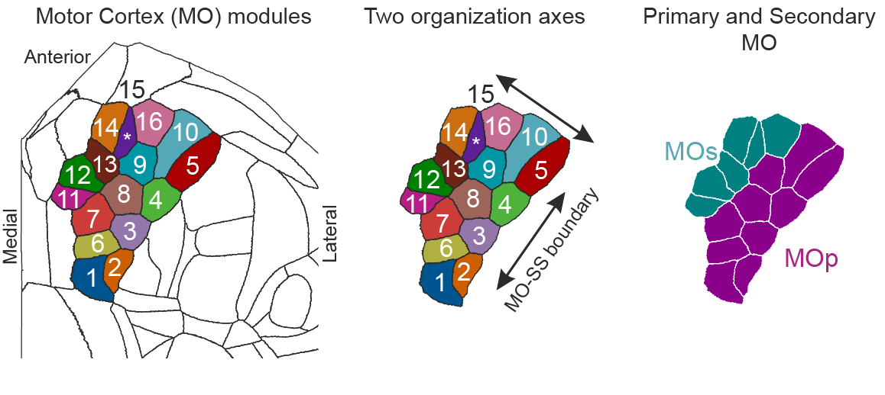
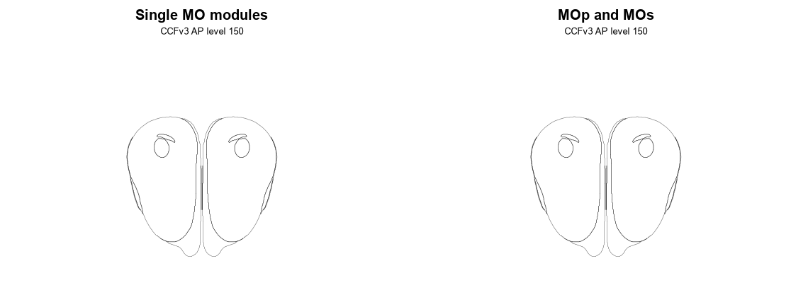

# The Allen MOmap Brain atlas has been added to BrainGlobe

Current atlases typically only divide the mouse motor cortex (MO) into broad primary and secondary fields, without fine-scale subdivisions supported by quantitative evidence. In their [new study](https://doi.org/10.1016/j.cell.2026.08.046), Falasconi, Kanodia et al. (2026) show that the subcortical projections of mouse MO define 16 different modules. Their modular map of the mouse MO is now available in BrainGlobe, built on top of the standard Allen Mouse Brain Atlas (CCFv3) template.

**Figure 1. Left: the 16 motor cortex modules defined by subcortical projection patterns, shown on a flattened top-down view of the isocortex. Middle: the two organisation axes, parallel and perpendicular to the MO-SS boundary. Right: the modules grouped into the primary (MOp; MO1-10) and secondary (MOs; MO11-16) motor cortex.**

The authors combined 547 tracer injections registered to the Allen Common Coordinate Framework (CCFv3) and clustered MO voxels by their projections to the striatum, thalamus, superior colliculus and medulla. The resulting 16 modules are arranged in three rows parallel to the boundary with somatosensory cortex (SS), defining two spatial MO axes: one running along the MO-SS boundary, and one perpendicular to it, towards the frontal cortex. Modules are characterised by specific patterns of cortical connections and cell-type make-up that vary along these two spatial dimensions, redefining the primary (MOp; MO1-10) and secondary (MOs; MO11-16) motor cortices. Note that MOmap moves the MOp/MOs boundary more rostrally than in the standard CCFv3 annotation.

The atlas uses the CCFv3 template and annotations at 10 μm resolution, with the motor cortex replaced by the 16 MOmap modules, so it stays compatible with the rest of CCFv3.

**Figure 2. Coronal sections through the MOmap atlas annotation from rostral to caudal. Left: the 16 motor cortex modules (MO1-16). Right: the modules grouped into the primary (MOp, magenta) and secondary (MOs, teal) motor cortex.**

We have packaged the following atlas:

* `allen_mouse_momap_10um`

## How do I use the new atlas?

You can use MOmap for analysis and visualisation in the same ways as other BrainGlobe atlases: 

* Install BrainGlobe ([instructions](/documentation/index))
* Open napari and follow the steps in our [download tutorial](/tutorials/manage-atlases-in-GUI.md) to download the `allen_mouse_momap_10um` atlas
* Visualise the different parts of the atlas as described in our [visualisation tutorial](/tutorials/visualise-atlas-napari)

## Why are we adding new atlases?

A fundamental aim of the BrainGlobe project is to make brain atlases easily accessible to users across the globe. MOmap lets users work with a finer division of the mouse motor cortex alongside the standard Allen CCFv3 atlas. If you would like to get involved with a similar project, please [get in touch](/contact).
