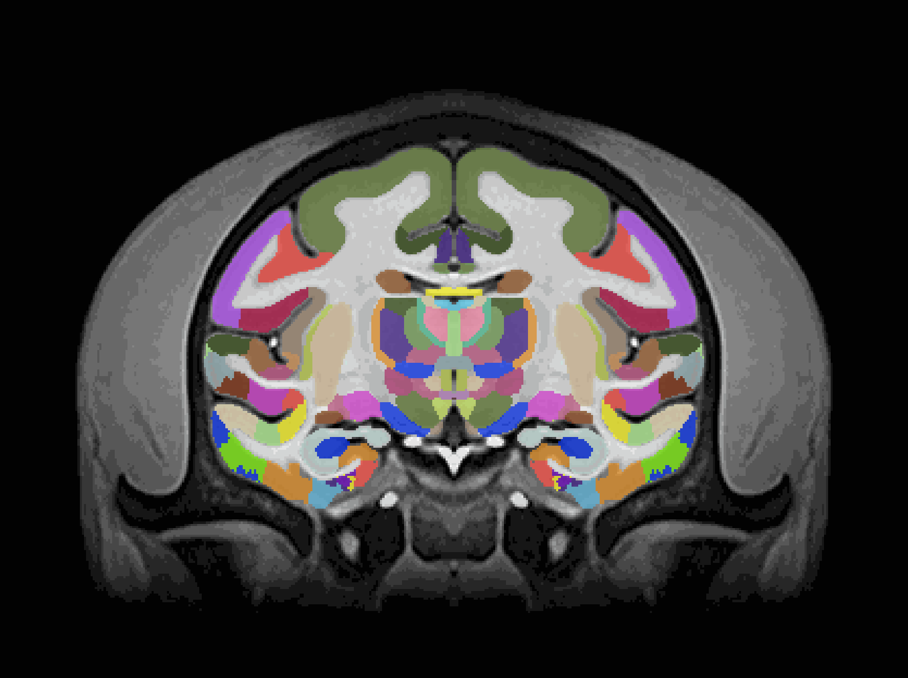

# NMT macaque brain atlases added to BrainGlobe

Three complementary rhesus macaque (_Macaca mulatta_) atlas families—CHARM, SARM and ARM—are now available through BrainGlobe, each in symmetric and asymmetric NIMH Macaque Template (NMT) v2.1 full-head space at 250 µm isotropic resolution. Together, these six atlas packages provide cortical, subcortical and combined annotations for a widely used model species in systems, cognitive and translational neuroscience.



**Figure 1. Coronal sections through the ARM annotations overlaid on the full-head NMT MRI reference, visualised with `brainrender-napari`.**

The [NMT](https://afni.nimh.nih.gov/pub/dist/doc/htmldoc/nonhuman/macaque_tempatl/template_nmtv2.html) is a population-average anatomical MRI template described by [Jung et al. (2021)](https://doi.org/10.1016/j.neuroimage.2021.117997). Symmetric templates provide a common reference for interhemispheric comparisons, while asymmetric templates retain population-level anatomical asymmetries. The full-head reference includes surrounding non-brain tissue, which can be useful for image alignment. Each package also includes a skull-stripped reference for inspecting brain anatomy without the surrounding head tissue.

Choose an atlas according to the anatomy and template symmetry you need:

| Atlas | Coverage | Symmetric atlas name | Asymmetric atlas name |
| --- | --- | --- | --- |
| CHARM | Cortex | `nmt_charm_sym_macaque_250um` | `nmt_charm_asym_macaque_250um` |
| SARM | Subcortex | `nmt_sarm_sym_macaque_250um` | `nmt_sarm_asym_macaque_250um` |
| ARM | Cortex and subcortex | `nmt_arm_sym_macaque_250um` | `nmt_arm_asym_macaque_250um` |

Within each symmetry variant, CHARM, SARM and ARM share the same anatomical references and coordinate space. This uses the shared-component support introduced in [BrainGlobe Atlas API v3](/blog/brainglobe-atlasapi-v3-release).

In all six packages, left and right homologues share a regional label and their meshes are combined into bilateral structures. The asymmetric versions retain asymmetric anatomy despite using shared labels across hemispheres.

## Cortical Hierarchy Atlas of the Rhesus Macaque (CHARM)

The [CHARM](https://afni.nimh.nih.gov/pub/dist/doc/htmldoc/nonhuman/macaque_tempatl/atlas_charm.html) is a hierarchical cortical atlas described by Jung et al. (2021). It parcellates the macaque cortex across six spatial scales, from broad cortical lobes to finer D99-derived cortical regions.

BrainGlobe packages the finest annotation level and retains the six-level structure hierarchy, so broader cortical regions remain accessible through their parent structures.

## Subcortical Atlas of the Rhesus Macaque (SARM)

The [SARM](https://afni.nimh.nih.gov/pub/dist/doc/htmldoc/nonhuman/macaque_tempatl/atlas_sarm.html) is a hierarchical subcortical atlas described by [Hartig et al. (2021)](https://doi.org/10.1016/j.neuroimage.2021.117996). It was built from high-resolution ex vivo structural imaging and histological data, then warped and refined in NMT v2 space.

SARM complements CHARM by covering structures including the basal ganglia, thalamus, hypothalamus, brainstem and cerebellum. As with CHARM, BrainGlobe packages the finest annotation level while retaining the six-level hierarchy of broader regions.

## Atlas of the Rhesus Macaque (ARM)

ARM combines CHARM and SARM into a single whole-brain hierarchy, with a top-level split between cortex and subcortex. Choose ARM when you want to work with cortical and subcortical regions together in one atlas.

## Source and citation

Please cite the publications underlying the atlas you use:

* **CHARM:** [Jung et al. (2021), *A comprehensive macaque fMRI pipeline and hierarchical atlas*](https://doi.org/10.1016/j.neuroimage.2021.117997), which describes NMT and CHARM.
* **SARM and ARM:** Jung et al. (2021) and [Hartig et al. (2021), *The Subcortical Atlas of the Rhesus Macaque (SARM) for neuroimaging*](https://doi.org/10.1016/j.neuroimage.2021.117996).

## How do I use the new atlases?

You can explore all six atlases in Neuroglancer without installing software:

| Atlas | Symmetric preview | Asymmetric preview |
| --- | --- | --- |
| CHARM | [Open CHARM](https://neuroglancer-demo.appspot.com/#!https://brainglobe.info/_static/neuroglancer/nmt_charm_sym_macaque.json) | [Open CHARM](https://neuroglancer-demo.appspot.com/#!https://brainglobe.s3.amazonaws.com/ng_state_files/nmt_charm_asym_macaque.json) |
| SARM | [Open SARM](https://neuroglancer-demo.appspot.com/#!https://brainglobe.info/_static/neuroglancer/nmt_sarm_sym_macaque.json) | [Open SARM](https://neuroglancer-demo.appspot.com/#!https://brainglobe.s3.amazonaws.com/ng_state_files/nmt_sarm_asym_macaque.json) |
| ARM | [Open ARM](https://neuroglancer-demo.appspot.com/#!https://brainglobe.s3.amazonaws.com/ng_state_files/nmt_arm_sym_macaque.json) | [Open ARM](https://neuroglancer-demo.appspot.com/#!https://brainglobe.s3.amazonaws.com/ng_state_files/nmt_arm_asym_macaque.json) |

For local analysis and visualisation, install BrainGlobe using our [installation instructions](/documentation/index). These packages use Atlas API v3; if you already have an installation, update it with:

```bash
pip install -U brainglobe-atlasapi
```

Then:

* Open napari and follow our [download tutorial](/tutorials/manage-atlases-in-GUI.md), selecting any of the six atlas names in the table above.
* Run `napari -w brainrender-napari` and visualise the different parts of the atlas as described in our [visualisation tutorial](/tutorials/visualise-atlas-napari).

For programmatic use, the atlases can be loaded through the BrainGlobe Atlas API in the usual way:

```python
from brainglobe_atlasapi import BrainGlobeAtlas

atlas = BrainGlobeAtlas("nmt_arm_sym_macaque_250um")
```

## Why are we adding new atlases?

A fundamental aim of BrainGlobe is to make brain atlases accessible across species, so researchers can use common analysis and visualisation tools. These macaque atlases extend that access to complementary cortical and subcortical resources. If you would like to contribute a similar atlas, please [get in touch](/contact).
