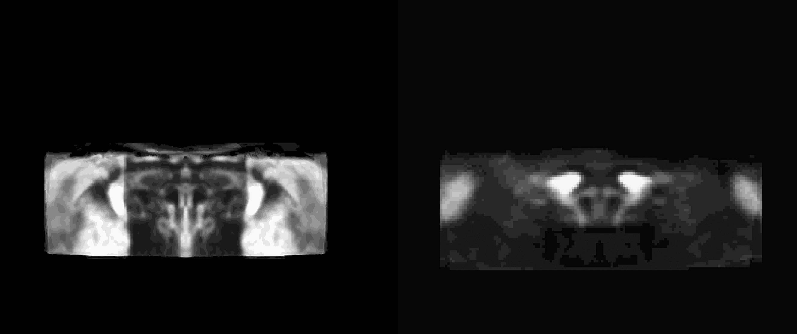
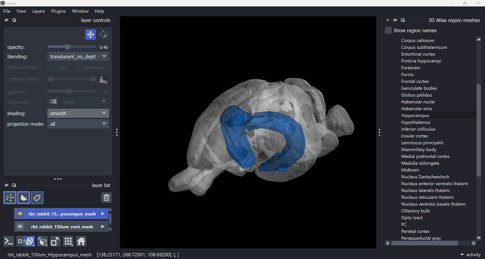

# An atlas for the New Zealand white rabbit, _Oryctolagus cuniculus_, has been added to BrainGlobe

Rabbits are a useful animal in neuroscience for studying brain development due to their human-like growth trajectories. However, its wide adoption as an animal model has been impeded by a lack of high resolution brain atlases. To this end, [Zhang et al. (2026) from Hainan University](https://dx.doi.org/10.24272/j.issn.2095-8137.2026.045) have developed RBT 1.0, a multi-modal, population averaged atlas of the New Zealand white rabbit. The authors integrated micro-CT, in-vivo and ex-vivo MRI scans of 10 adult male rabbits aged around 8 weeks to create two templates, namely a T1-weighted and T2-weighted MRI template. The template was then manually annotated to give rise to this atlas, available at 150μm and 330μm resolutions. The team at BrainGlobe have packaged this atlas to make it accessible through our ecosystem, and to allow a wider audience to use this atlas for rabbit research. 

The atlas is available at two resolutions:
* `rbt_rabbit_150um`
* `rbt_rabbit_330um` 

**Figure 1. Coronal flythrough of the RBT rabbit brain atlas with template and annotations. Left: 150μm T1w template. Right: 330μm T2w template.**

## How do I use the new atlases?

You can use the RBT rabbit atlas for analysis and visualisation like other BrainGlobe atlases. To visualise the atlases, you can either open them in Neuroglancer for viewing in the browser [here](https://neuroglancer-demo.appspot.com/#!https://brainglobe.s3.amazonaws.com/ng_state_files/rbt_rabbit.json), or you can view them locally:

* Install BrainGlobe ([instructions](/documentation/index))
* Open napari and follow the steps in our [download tutorial](/tutorials/manage-atlases-in-GUI.md) for the RBT atlas
* Visualise the different parts of the atlas as described in our [visualisation tutorial](/tutorials/visualise-atlas-napari)

The end result will look something like Figure 2.

**Figure 2: The RBT Rabbit Brain atlas visualised with `brainrender-napari`: with mesh overlays for the brain (grey) and the hippocampus (blue).**

## Why are we adding new atlases?

A fundamental aim of the BrainGlobe project is to make various brain atlases easily accessible by users across the globe. The RBT Rabbit Brain atlas allows for users to access a high resolution rabbit brain atlas easily on BrainGlobe. If you would like to get involved with a similar project, please [get in touch](/contact).
